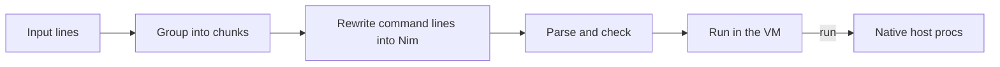

# nish

A terminal shell whose language is [NimScript](https://nim-lang.org/docs/nims.html), the subset of Nim that runs in the compiler's VM.

> [!WARNING]
> nish is an early spike and is missing most of what you expect from a shell: pipes, redirects, globs and job control are not there yet.

## What it looks like

Input is Nim. A line is a shell command only when its first word is not a Nim keyword or a symbol in scope but does name a program on your `PATH`.

```nim
nish> let dirs = @["src", "tests"]
nish> for d in dirs:
  ...   ls -1 @(d)
  ...
nish> echo "HOME is ", getEnv("HOME")
nish> cd "/tmp"
```

- `ls -1 @(d)` is a command, and `@(d)` puts the value of the Nim expression `d` into it as one argument.
- `echo` is Nim's `echo`, because Nim wins whenever a name means something in Nim.
- Commands work anywhere a statement does, including inside loops and procs.
- The NimScript API that `.nims` files have (`cd`, `getEnv`, `listFiles`, `exec` and so on) is built in.

Scripts work the same way:

```sh
nish script.nims
nish -c 'for i in 1..3: echo i'
```

## How it works

nish links the Nim compiler in as a library and keeps one VM module alive for the whole session, so everything you define stays in scope. Each chunk of input goes through these steps:



Command lines become calls like `run(@["ls", "-1", $(d)])`. `run` is declared in Nim and implemented natively in nish, where it starts the program attached to the terminal.

## Building

nish pins Nim 2.4.0 with [mise](https://mise.jdx.dev), because it uses the compiler's internal API.

```sh
mise plugin install nim https://github.com/elijahr/vfox-nim
mise install
nimble build   # produces ./nish
nimble test
```

The binary carries the Nim standard library with it and unpacks it into your cache directory the first time it runs, so it doesn't need Nim installed. `./nish --timing` prints how long the VM took to start.

## License

[0BSD](LICENSE)
