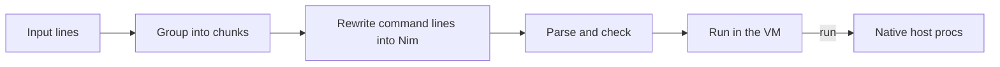

# nish

A terminal shell whose language is [NimScript](https://nim-lang.org/docs/nims.html), the subset of Nim that runs in the compiler's VM.

> [!WARNING]
> nish is young. It has the pieces a daily shell needs, but expect rough edges.

## What it looks like

Input is Nim. A line is a shell command only when its first word is not a Nim keyword or a symbol in scope but does name a program on your `PATH`.

```nim
nish> let dirs = @["src", "tests"]
nish> for d in dirs:
  ...   ls -1 @(d)
  ...
nish> git log --oneline | head -3 > ~/recent.txt && cat ~/recent.txt
nish> let branch = sh"git branch --show-current"
nish> echo "on ", branch, " in ", getEnv("HOME")
nish> cd /tmp
```

- Command lines have shell syntax: pipes, `>`, `>>`, `<`, `2>&1`, `&&`, `||` and `;`, with globs, `~` and `$VAR` expanded in unquoted words.
- `@(d)` puts the value of the Nim expression `d` into a command. A sequence becomes one argument per element.
- `sh"..."` runs a command line and returns its output as a string; `lastStatus` holds the exit status of the last command.
- `echo` is Nim's `echo`, because Nim wins whenever a name means something in Nim. Three things override that: a line containing `&&`, `||`, `>>` or `>&` is always a command, since those are never Nim; a leading `!` makes the whole line a command (`!echo x | wc -l`); and `run"echo x | wc -l"` is plain Nim.
- `;` separates statements, each of which can be Nim or a command: `ls; echo "done"`.
- Commands work anywhere a statement does, including inside loops and procs.
- Job control works as you'd expect: `cmd &` runs in the background, Ctrl-Z stops the foreground job, and `jobs`, `fg` and `bg` manage them.
- The NimScript API that `.nims` files have (`cd`, `getEnv`, `listFiles`, `exec` and so on) is built in. `cd`, `exit`, `jobs`, `fg` and `bg` also work as commands.

Scripts work the same way:

```sh
nish script.nims
nish -c 'for i in 1..3: echo i'
cat script.nims | nish
```

A script stops at its first error, and nish exits with the status of the last command, as other shells do.

## Customizing

nish runs `~/.config/nish/init.nims` when an interactive session starts (not for scripts, `-c` or piped input). It's NimScript like everything else, and it configures the shell by setting hooks:

```nim
import std/strutils

alias "ll", "ls -la"
alias "gs", "git status"

prompt = proc(): string =
  let branch = sh"git branch --show-current 2> /dev/null"
  tildePath(getCurrentDir()) & (if branch.len > 0: " (" & branch & ")" else: "") & "> "

onDirChange.add proc(dir: string) =
  ls

completers.add proc(line, word: string): seq[string] =
  if line.startsWith("git "): @["status", "commit", "push"] else: @[]
```

The hooks are `prompt`, `continuationPrompt`, `onPreCommand`, `onCommandDone`, `onDirChange` and `completers`; they run for input at the prompt, not for scripts. A plugin is a Nim module in `~/.config/nish/plugins/` (directly or one directory down, so a cloned repository works as it is) that you `import` from `init.nims`. Tab completes programs, Nim symbols in scope, builtins and file names, plus whatever the completers add. History is kept in the nish data directory.

Prompts can use colors. Keys can be bound to Nim procs, which edit the input through `editorText`, `editorCursor`, `editorSetText` and `editorInsert`:

```nim
bindKey "ctrl-t", proc() =
  editorSetText("time " & editorText(), editorCursor() + 5)
```

The editor itself handles multi-line input: Enter adds a line while a block is open and accepts when it's complete, Ctrl-J always adds a line, and a pasted block becomes one input. Ctrl-R searches the history, and the usual Emacs keys work.

## How it works

nish links the Nim compiler in as a library and keeps one VM module alive for the whole session, so everything you define stays in scope. Each chunk of input goes through these steps:



Command lines become calls like `run("ls -1 \0", d)`, where the NUL stands for the spliced value. `run` is declared in Nim and implemented natively in nish, which parses the shell syntax, expands the words and starts the processes with pipes between them.

## Building

nish pins Nim 2.4.0 with [mise](https://mise.jdx.dev), because it uses the compiler's internal API.

```sh
mise plugin install nim https://github.com/elijahr/vfox-nim
mise install
nimble build   # produces ./nish
nimble test
```

The binary carries the Nim standard library with it and unpacks it into your cache directory the first time it runs, so it doesn't need Nim installed. `./nish --timing` prints how long the VM took to start.

## License

[0BSD](LICENSE)
