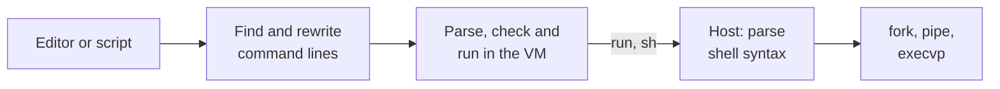

# Architecture

nish links the Nim compiler in as a library. It keeps one VM module alive for the whole session, rewrites command lines into Nim calls, and runs the processes itself. This page describes how the pieces fit together; the source files in `src/nish/` have the details.

## From input to output

1. **Input.** At the prompt, the [line editor](#the-line-editor) reads a whole input, which may span lines. A script is split into its top-level statements, so commands in later statements can use names defined in earlier ones (`input.nim`).
2. **Finding commands.** `commands.nim` decides which lines are commands. It follows the Nim structure of the input (`lineContexts`), so lines in declarations, brackets, continued expressions and comments are never commands, and names declared earlier in the input count as Nim. The rest is decided by asking the session whether a name is a Nim symbol in scope, and the file system whether it is a program.
3. **Rewriting.** A command line becomes a call: `ls -l @(dir)` turns into `run("ls -l \0", dir)`. The shell syntax stays a string; only the `@(...)` expressions become Nim.
4. **Evaluation.** The session parses, checks and runs the result in the VM.
5. **Running processes.** `run` and `sh` are declared in Nim and implemented natively. The host parses the shell syntax, expands words and starts the processes.

## The session

`session.nim` owns the compiler state: a module graph, one module standing in for the input, its semantic context and the VM. The compiler's own REPL loop stops at the first error and loses the module's scope, so nish drives the steps itself: it parses each input, runs `semWithPContext` on it, and hands the result to the VM with `interpreterCode`. An error in one input is reported, and everything defined before it stays.

The session defines `nimconfig`, which brings in `system/nimscript`, the API `.nims` files have, implemented by the compiler's `setupVM`.

Compiler errors arrive through `structuredErrorHook`. nish shows the first error of each input with a position that makes sense where it happened: none at the prompt, `line N:` further into an input, the file name in scripts. The compiler's own printing to stderr is switched off, which leaves `echo` from scripts on stdout.

## Calling between nish and the VM

`script/nishapi.nim` is the Nim side of nish's API, imported into every session. Some of its procs have placeholder bodies, and the VM calls a native implementation from `host.nim` instead. The VM finds these callbacks by name, `<package>.<module>.<proc>`, and the session asks the compiler for `nishapi`'s package name when it registers them.

In the other direction, nish calls entry points in `nishapi` (`nishPrompt`, `nishComplete`, `nishCommandDone` and so on) with `vm.execProc`. These run the hooks that `init.nims` and plugins set. If a hook raises, nish clears the VM's pending exception and leftover frames, uses a fallback, and the session carries on.

## Processes and jobs

`pipeline.nim` parses a command line into steps of pipelines, expands each word (splices, `$VAR`, `~`, globs) and starts the commands with `fork`, `pipe` and `execvp`. Between `fork` and `execvp`, only async-signal-safe calls are allowed, so everything the child needs is prepared before the fork.

`jobs.nim` tracks each pipeline as a job. At an interactive terminal, every job gets its own process group, and the foreground job owns the terminal (`tcsetpgrp`) until it exits or stops. The shell ignores the terminal stop signals itself and resets them in its children, which is what lets Ctrl-Z stop a job without stopping nish.

## The line editor

`editor.nim` puts the terminal into raw mode while it reads an input, with `TCSADRAIN` so typed-ahead and pasted input is never thrown away, and turns on bracketed paste so a pasted block arrives as one piece. It keeps the whole input, which may span lines, and redraws it after every key, tracking which row the cursor is on so it can get back to the top even when lines wrap. Prompts may contain color codes; they don't count toward the width. Enter accepts the input once it's complete by the prompt's rules (`input.needsMoreInput`): a line that opens a block or ends in an operator asks for more, and a blank line ends a block. Scripts are split differently, by looking ahead to where the next top-level statement starts.

## The embedded standard library

The VM compiles the standard library from source, so it needs the files at runtime. `embedded.nim` builds the portable parts of the library (about 5 MB) and `nishapi.nim` into the binary, and unpacks them into the cache directory on first use. Each lands in a directory named after a hash of its contents. A directory is built under a temporary name and moved into place with one `rename`, and never changed afterwards, so shells starting at the same time, or different versions of nish, can't break each other.
